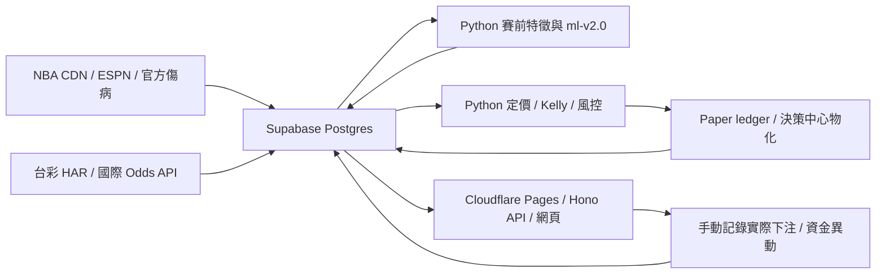

# 專案恢復工作前稽核（2026-10-15）

> 後續狀態：下述 P1/P2 已在本機修正並補回歸案例，尚未部署。詳見 [D.5 修正驗收](phase-d5-fixes-2026-10-15.md)。本報告保留修正前的稽核證據。

稽核版本：`ffcd191`（`main`）。本次目的為確認 Phase E 前的基礎與缺口；未修改模型、策略、應用程式或正式資料。

## 判定

**A–D 主體已完成，無須重做；但 D.5 有兩個已重現的風控缺口，修正前不宜宣告前階段完全驗收。**

Phase E 可以開始規劃與離線研究；若要把新功能接入日常決策，應先處理下列 P1/P2，再驗證開季的真實資料流程。現有測試通過，並不涵蓋這兩個邊界案例。

## 專案導覽

- 網站：`src/routes/`、`src/db/`、`src/lib/`、`src/pages/`；瀏覽器腳本在 `public/static/js/`。
- 資料與模型：`pipeline/core/sources/`、`jobs/`、`models/`、`production/`。
- 定價與決策：`pipeline/core/odds/`、`pricing/`、`sizing/`、`execution/`、`decision/`。
- 排程：`pipeline/core/scheduling.py` 定義 13 個 jobs；`pipeline/scheduler.py` 啟動。
- 正式資料庫以 Postgres migrations 為準；D1 是網站的本機開發／驗收用途。
- 現行生產模型是 Logistic / Ridge，這是 C.5C 比較後的選擇，並非忘了完成原始規格中的 XGBoost。

| 階段 | 已有內容 | 本次判斷 |
|---|---|---|
| 網站第一階段 | 賽事、詳情、傷病、績效、投注、登入、狀態頁 | 建置、API 與登入測試通過 |
| A / C.5A / C.5B | 資料來源備援、排程、五季回填、傷病快照、衍生指標 | 正式資料覆蓋率與原始報告相符 |
| B / C / C.5C | Elo、時間尺度特徵、walk-forward 模型比較 | 重新執行評估可重現既有主要結果 |
| C.5D / C.5E | 版本化 artifact、推論、重訓、任意盤線機率與 push | 當前 artifact 可載入並通過完整性驗證 |
| D.1–D.3 | 盤口正規化、去水、EV、push-aware Kelly、risk-v1 | 已有實作與測試；正式盤口仍為 0 |
| D.4 | T-60 as-of 執行、結算、獨立 paper ledger | 已有實作；真實前瞻樣本尚未累積 |
| D.5 | 決策中心、actual exposure、append-only bankroll、下注稽核 | 主體完成；有下述兩個需修正項目 |
| E | 球員／lineup、旅行／裁判、line movement、Telegram／LINE | 選做，尚未實作 |

## 已驗證問題

### P1：更正注單可跳過風控，並沿用原本的合規標記

位置：`src/routes/decision.ts:510`、`:528`、`:539`。

`POST /api/bets/:id/correction` 接受新的 stake / odds / selection / line，但未執行 `evaluateBet`。它複製舊列的 `strategy_compliance` 與 override 資料，再將 risk check 寫成 `skipped: correction`。

本機獨立 D1 重現：

1. 先執行既有 API smoke test，建立一筆 `compliant` 平台注單。
2. 找到該筆有效注單（本次 stake = 392）。
3. 呼叫更正端點，送出 `{"stake":50000,"reason":"audit correction above 2 percent cap"}`，沒有 `confirm_override`。
4. 回傳 **HTTP 201**，新 stake = **50,000**，`strategy_compliance` 仍為 **`compliant`**。
5. Seed 的 day-start bankroll 為 100,000，risk-v1 單筆上限為 2,000。

影響：不能信任更正後的合規標記；更正可避開新增下注時的超額確認。下一輪 Python 仍會把新 stake 納入 exposure，並不代表後續額度完全不設防。這是記錄與合規流程的缺口，平台本身不會向 bookmaker 下單。

修正方向：更正須按「移除被取代注單、納入更正值」的情境重新驗證，或採用明確且保守的更正合規狀態與確認流程；不能直接沿用 `compliant`。避免把被取代注單重複計入。若缺乏足夠上下文，應明確標示 `missing_context`，保留原有稽核軌跡。

必要回歸案例：更正提高 stake 超過單筆／同場／單日上限、改方向／盤線、減少 stake、重複送出與併發，以及舊列保持不可覆寫。

### P2：出金 API 接受過期的物化餘額

位置：`src/routes/decision.ts:665`，關鍵條件為 `:673`。

出金僅拒絕 `risk.status === 'recalculation_pending'`，沒有拒絕 `stale`。這與同處註解及 D.5 報告「物化過期 → 409」的契約不符。

本機獨立 D1 重現：

1. 建立測試帳號與 10,000 初始資金。
2. 以測試 fixture 建立最後確認時間在 20 分鐘前的 snapshot，讓帳戶版本、ledger 與 event watermark 都一致，隔離「單純過期」情境。
3. `GET /api/bankroll` 回傳 `summary_state.status = stale`、`capacity_valid = false`。
4. 送出 `{"entry_type":"withdrawal","amount":1000}`。
5. API 仍回 **HTTP 201**，建立 withdrawal。

影響：排程中斷或摘要未被確認時，仍使用過期可用餘額作判斷。這是手動 strategy bankroll 的帳務紀錄，並非銀行實際提款。

修正方向：以 `risk.capacity_valid`／明確 `current` 狀態作為出金前提，讓 `stale`、版本變動與尚未物化均回 409。加入單純過期但版本一致的回歸測試。

## 本次驗證結果

| 檢查 | 結果 |
|---|---|
| `npm run build` | 通過 |
| `npm run test:auth` | 14 passed |
| Python 純邏輯測試 | 607 passed、134 個 DB cases 另跑 |
| Python Postgres 整合測試 | 134 passed（約 17 分鐘）；Python 兩組合計 741 passed、0 failed |
| API smoke（獨立本機 D1，全部 migrations + seed） | 160 passed / 0 failed |
| 額外 D.5 邊界重現 | 上述兩個問題均重現 |
| C.5C 完整離線重新評估 | 通過，主要結果與既有輸出一致 |
| C.5E 離線重新評估 | 通過；分佈選擇、評測結果與 moneyline 比較均與既有輸出一致 |
| 瀏覽器檢查 | 登入成功；8 個資料頁面皆 HTTP 200、無頁面 runtime error／資料載入失敗 |
| 正式 readiness（`--post-deploy`） | DB、migrations、關鍵排程心跳通過；整體 WARN 含本機環境設定警告 |
| 正式 seed／帳號稽核 | 沒有 demo/test 帳號與 seed 假績效；實際下注 0 |

DB 整合測試使用隨機暫存 schema，並於結束清除；API smoke 與問題重現只寫入 `/private/tmp/nba-project-audit-20261015/` 的隔離 D1。正式資料庫的稽核使用唯讀查詢。未執行正式 migration、seed、HAR 匯入、重訓 promotion 或部署。

### 模型可重現性

使用既有本機原始輸入快照，重新建特徵、驗證季選擇、walk-forward 評估與比較；所有新輸出放在上述暫存目錄，未覆蓋原始評估檔或模型。

評測集合：2024-25（1,315 場）＋ 2025-26（1,316 場），合計 2,631 場。驗證季選出的 production 特徵組與既有結果一致。

| 指標 | 選定模型 | Baseline | 本次重跑與既有值 |
|---|---:|---:|---|
| 勝負 Log Loss | 0.592212 | 0.622105 | 相同 |
| 勝負 Brier | 0.203584 | 0.215031 | 相同 |
| 勝負 accuracy | 67.92% | 66.97% | 相同 |
| 分差 MAE | 10.9784 | 11.3431 | 相同 |
| 總分 MAE | 14.9250 | 15.2161 | 相同 |
| 上半場分差 MAE | 8.8660 | 8.9599 | 相同 |
| 上半場總分 MAE | 9.6373 | 9.8934 | 相同 |

Mac 的 XGBoost 額外需要 OpenMP。直接執行評估會因找不到 `libomp.dylib` 失敗；依既有 C.5C 報告，設定 `DYLD_FALLBACK_LIBRARY_PATH` 指向 `.venv/lib/python3.11/site-packages/sklearn/.dylibs` 後即可完整執行，未安裝新系統套件。這是本機研究環境需求；現行 production 推論使用 Logistic / Ridge，Docker 也已安裝 `libgomp1`。

C.5C 的完整 `eval`、`compare`、`decision_time` 與驗證季模型選擇皆與既有 JSON 相等。C.5E 亦重新產生 42,064 列 OOS 預測，`selection`、`eval`、`moneyline_comparison` 均與既有 JSON 相等；這是重現既有研究，不新增前瞻驗證證據。

Playwright 以獨立瀏覽器登入本機 seed 帳號，檢查 `/`、`/decision`、`/bankroll`、`/bets`、`/injuries`、`/performance`、`/status`、`/games/1`，頁面載入成功且無 JavaScript runtime error；未執行視覺設計或跨裝置完整驗收。

### 正式資料與執行狀態

- 五季 final 賽事 6,605 場；比分、逐節、加總一致性與半場欄位全數完整。
- 6,604 場具備完整官方 ID／球隊與球員 box score／衍生指標。唯一缺漏為原先已記錄的 2023-24 DET@ATL，保留 ESPN 比分與逐節。
- 雙隊賽前傷病報告涵蓋率為各季 99.85%–100%，與 C.5B 記錄相符，沒有將缺漏補造為健康。
- Postgres 0001–0008 全部套用；`decision_board`、`market_pricing`、`bet_sizing`、`paper_strategy` 心跳新鮮，排程已實際運作。
- 1 位真實使用者、1 個 bankroll、1 筆 initial funding；實際 bets、盤口、定價、注碼、paper decisions / bets、ml-v2 predictions 皆為 0。
- 本機 artifact `ml-v2.0+20261004T0339Z.20261004T033948Z`：schema 2、dist-v2、SHA-256 驗證與載入通過。
- `run_production_check.py` 同時讀取「本機環境／artifact」與「正式 DB 心跳」。本次未掛 volume、未設 TZ、TWSPORT_ENABLED 預設 true 等警告，是本機環境觀測，不能據此宣稱 Railway 設定有誤，也不能證明遠端 volume 持久化正常。

### 為什麼目前沒有未來賽事

已唯讀取得 NBA 官方 `scheduleLeagueV2.json`：season 2026-27、1,200 場符合正規化條件的例行賽，第一場在 `2026-10-20T19:00:00Z`（台灣 10/21 03:00）。

`run_daily_schedule` 只同步 `[now − 24h, 台灣明日結束)`，本次到台灣 10/17 00:00；視窗內為 0 場。因此「正式 DB 沒有未來賽事」在本次符合設計，不等於 NBA 尚未公布賽程。季前賽刻意排除。

## 尚待真實賽事驗證的部分

1. **台彩盤口依賴手動 HAR**。自動化抓取被擋且未繞過，未提供 HAR 時不會有台彩可操作機會。這是現行接受的營運限制。
2. **完整正式流程還沒有真實樣本**。已有測試與心跳，仍須在賽程進窗後確認：同步 → early / final 預測 → HAR → 定價／sizing → T-60 paper → final 賽果 → 結算／ledger。
3. **沒有投注獲利證據**。歷史模型比較不等於市場 edge 或 ROI；盤口與 paper 樣本目前都為 0。
4. **dist-v2 的 μ = 0 是評測後修正**，已明確記錄；2026-27 才是前瞻驗證期。Phase E 不應用已看過的評測季結果反覆調現行 production 規則。
5. **未直接驗證線上網站與 Railway 控制台**。本次驗證本機 Cloudflare runtime、正式 DB 與排程寫入結果；未取得經確認的正式網站 URL，未檢查遠端部署版本、登入 CPU 限制、volume 重部署持久性或實際費用。

## 文件與維護缺口

- README 仍寫 API 106 項，實際 160 項；進度表缺 D.5，但開頭與程式已有 D.5。
- README 的「0008 尚待套用」與「排程器尚待部署」已過時；本次正式 DB 證據顯示已完成。Cloudflare 網站是否部署仍須直接查線上環境。
- `docs/phase-d5-report.md` 是完成當時的歷史快照；不要將其「未套用／未 commit」當成今天狀態。
- 專案沒有 TypeScript typecheck script，且本機未安裝 TypeScript；`vite build` 通過只證明轉譯／打包，不能視為 `tsc --noEmit` 通過。可於後續維護加入型別檢查與生成 binding types。
- 部分停用／備援來源的舊 `data_sources` 列會顯示 stale；應區分 inactive 與必要來源中斷，避免影響狀態頁判讀。

## 建議推進順序

1. 先修正 D.5 更正合規與過期出金兩處，加入上述回歸案例，再重跑相關檢查。
2. 更新 README 的當前狀態與驗收數字；將操作方式以 production runbook 為準。
3. 在首批真實賽事完成既有流程驗收，開始累積 prospective paper 資料。
4. Phase E 先選擇不改模型的推播功能較容易控制範圍；球員／lineup、旅行／裁判、line movement 應各自作研究題目。
5. Line movement 特徵需先累積真正盤口時間序列；目前 0 筆盤口，尚不具備研究資料。新增模型需保留版本與時間切分，避免與凍結的 ml-v2.0／dist-v2／risk-v1／execution-v1 證據混用。

參考文件：`NBA預測平台規格書_兩階段.md`、`docs/phase-c5a-report.md` 至 `phase-c5e-report.md`、`docs/phase-d1-report.md` 至 `phase-d5-report.md`、`docs/production-runbook.md`。

本機 Cloudflare 驗證方式參照 [Pages local development](https://developers.cloudflare.com/pages/functions/local-development/)；資料庫 runtime 檢查亦參照 [Cloudflare Postgres.js 指引](https://developers.cloudflare.com/hyperdrive/examples/connect-to-postgres/postgres-drivers-and-libraries/postgres-js/)。
